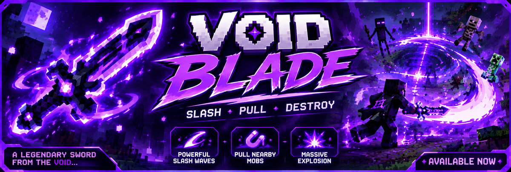

<p align="center">
  
</p>

<h1 align="center">Voidblade</h1>

<p align="center"><b>Slash. Pull. Destroy.</b> ...well, not the last one. Voidblade is a non-combat dimensional tool for Minecraft (Fabric).</p>

---

## Install

1. Install [Fabric Loader](https://fabricmc.net/use/) for **Minecraft 26.3** (Java 25).
2. Put [Fabric API](https://modrinth.com/mod/fabric-api) and `voidblade-1.jar` in your `mods` folder.
3. Works in singleplayer and on servers. Install on the server **and** on every client that should see the effects.

## Crafting

```
Amethyst Shard | Ender Pearl | Amethyst Shard
Obsidian       | Echo Shard  | Obsidian
Amethyst Shard | Obsidian    | Amethyst Shard
```

Or `/give @s voidblade:voidblade`.

## How to use

| Action | Result |
|---|---|
| **Right-click** | **Rift Anchor:** return to your saved location (safe landing spot is found automatically) |
| **Sneak + right-click** | Save your current location as the anchor |
| **Hold in either hand** | **Void Magnet:** pulls dropped items and XP orbs within 8 blocks. Never touches living entities. **Crouch** to pause it. |

Returning has a 6 second cooldown (1 second after saving): you see the item cooldown sweep and a recharge bar in the action bar.

## Commands

| Command | What it does |
|---|---|
| `/voidblade slot <1-5>` (or `/vb`) | Select the active Rift Anchor slot |
| `/voidblade list` | Show all five anchors |
| `/voidblade clear [n]` | Clear a slot (default: the selected one) |

No operator permission needed, so it works in survival.

## Releases

Every update is its own GitHub release (v1, v2, v3, ...) and old ones are kept, so you can compare them under [Releases](../../releases).

## Build it yourself

```
./gradlew build
```

The jar is in `build/libs/voidblade-1.jar`. Needs JDK 25. Pushing to GitHub builds it automatically and publishes a release `v1` (see `.github/workflows/build.yml`).

## License

MIT
